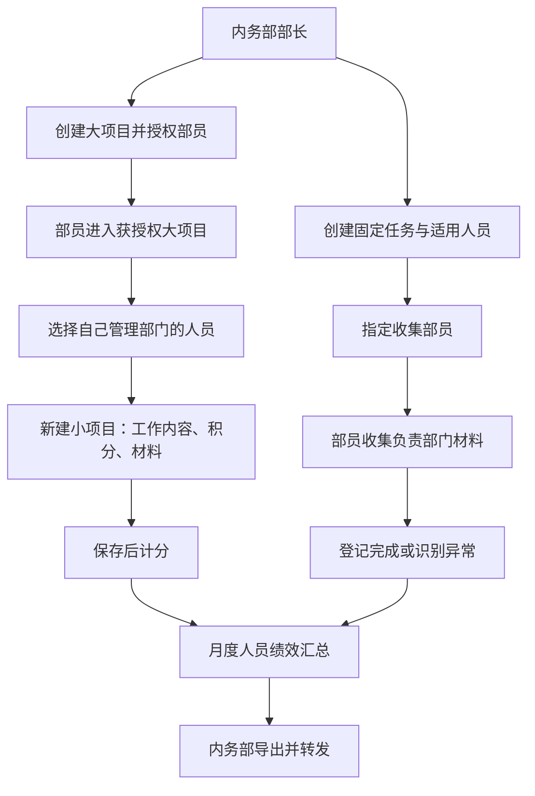
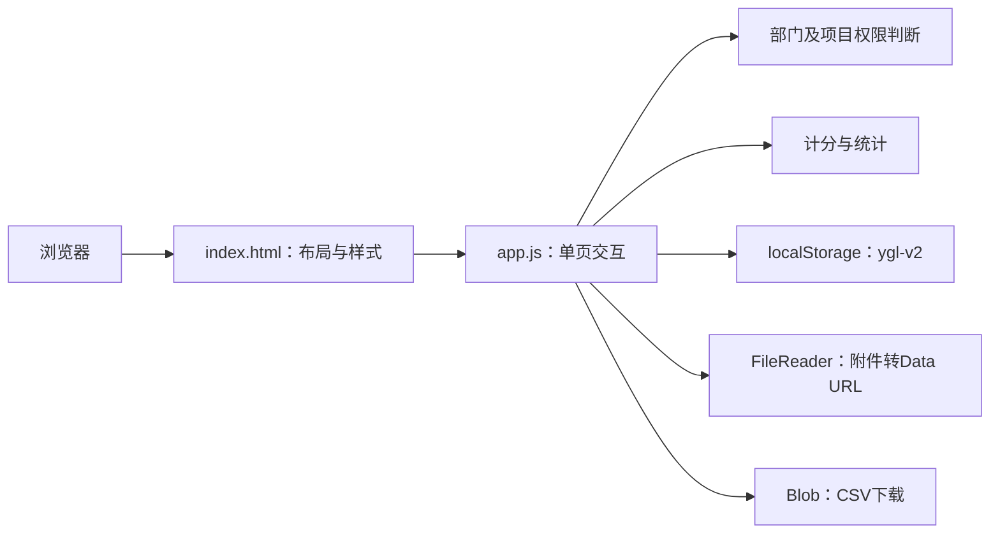
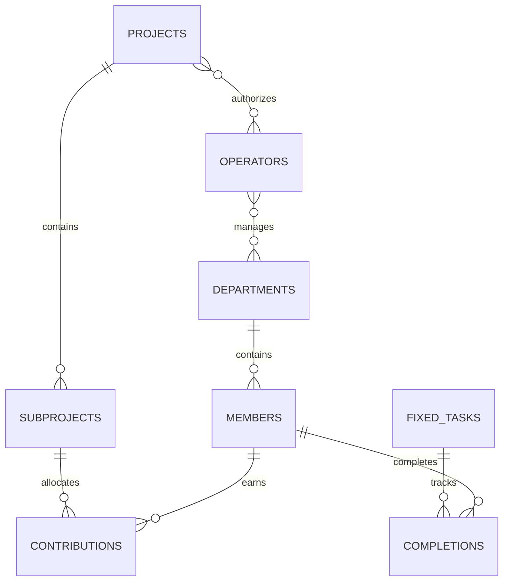
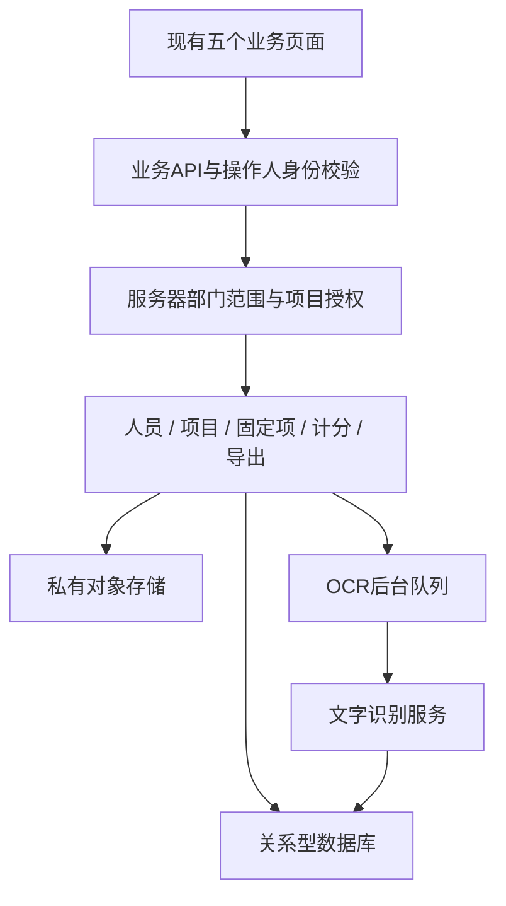

# 粤港联绩效登记管理系统：设计架构

版本：2026-10-28。本文以当前用户确认的简化流程为准，区分已经实现的演示架构与正式多人使用需要补齐的服务。

## 1. 业务范围

五个被管理部门：策划部、会务部、内务部、公关部、宣传部。只有内务部操作系统。其他部门通过现有沟通渠道提供分工、成果和截图，接收内务部转发的报表。上级审核在系统外进行，不设置系统审核流程。

核心是两条登记链路：



不设置“核对与审核”“考核设置”页面。登记不需要经过系统内部长审批、公示审批或上级审批才能计分。

## 2. 操作人和部门范围

| 身份 | 可见范围 | 管理权限 |
| --- | --- | --- |
| 内务部部长 | 全部五部门、全部项目和报表 | 分配部员负责部门，维护成员，创建大项目与固定任务，登记及修改绩效 |
| 内务部部员 | 仅自己负责部门人员及相关数据 | 在获授权大项目下登记自己负责人员贡献；在被指派固定任务中管理这些人员完成情况 |
| 其他部门人员 | 无系统访问身份 | 通过群聊等既有渠道提交资料、接收转发信息 |

部门管理范围和项目授权是两个条件，必须同时满足。获得大项目授权，不等于可以管理所有部门。

权限表达式：

```text
可查看成员 = 部长，或成员所属部门属于当前部员负责部门
可进入大项目 = 部长，或当前部员在项目授权列表中
可登记小项目 = 可进入大项目，且项目进行中，且所有参与人均在管理范围
可编辑小项目 = 部长，或原登记部员且当前仍具备对应项目和人员范围
可收集固定任务 = 部长，或被指定为收集人且任务包含负责部门人员
可修改完成记录 = 可收集该任务，且目标人员属于任务名单及管理范围
```

人员选择器、列表、工作台统计、固定项进度、报表和导出都采用同一部门范围。负责部门撤销后应立即失去访问权。

当前实现对跨部门混合小项目采用保守规则：部员只有能管理该小项目全部参与人时才能看到它，部长始终可见。后续若需要多个收集部员协作同一个小项目，可按部门分开登记独立工作阶段；如实现部分可见，附件与任务总积分也需分范围处理。

## 3. 页面与功能

| 页面 | 当前操作 |
| --- | --- |
| 工作台 | 负责部门、人员数量、项目数量、登记积分、部门平均分 |
| 自由项项目 | 大项目创建、说明、授权、状态；进入项目创建小项目；多人分工与分配积分；成果和附件；详情与编辑 |
| 固定项收集 | 部长建任务、设适用人员及收集人；部员上传材料、标记完成和异常；部长登记豁免 |
| 绩效报表 | 选定月份、部门筛选、姓名搜索、原始积分、模块分数、总分、CSV导出 |
| 成员与权限 | 部长新增及维护成员、停用成员、分配部员负责部门；部员仅查看负责人员 |

操作反馈采用弹窗，取消应仅关闭弹窗，不提交数据。保存后更新本地状态与相关列表。

## 4. 当前技术架构



运行时不依赖服务器接口、数据库或第三方SDK。HTML引用`app.js`，脚本维护页面、当前角色、选定月份、选定项目、筛选条件，并以`render()`重新生成界面。

主要函数职责：

| 函数 | 职责 |
| --- | --- |
| managedDepartments / allowedMember | 计算操作人的部门及人员范围 |
| canProject / canTask / visibleSub | 项目、固定任务和小项目访问判断 |
| projectView / editProject / editSub | 自由项项目与登记 |
| taskView / editTask / verify | 固定任务和材料登记 |
| results | 按人员和月份计算两类分数 |
| commit | 写入操作日志并保存状态 |
| modal / closeModal | 创建弹窗、保存及取消 |
| exportReport | 生成当前范围CSV报表 |

取消按钮修复：旧代码把`modal.close()`绑定在按钮上，但`modal`也是创建弹窗的函数名，覆盖了浏览器按元素ID提供的全局引用。改用`closeModal()`，内部显式定位`document.querySelector('#modal')`并关闭。

## 5. 数据模型

当前数据为一个本地JSON对象：

| 集合 | 核心字段与关系 |
| --- | --- |
| members | id、name、dept、active；被管理人员，与系统操作人分开 |
| operators | id、name、departments；内务部操作人及负责部门 |
| projects | id、name、description、auth、status；顶层大项目 |
| subs | id、project、name、date、month、points、creator、contrib、evidence、files、status |
| contrib | member、work、points；某小项目下的个人贡献 |
| tasks | id、name、kind、month、deadline、members、collectors、records |
| records | 以成员ID索引：status、note、files；固定任务完成信息 |
| cycles | 以月份索引：target等；作为计分参数，不提供独立设置页面 |
| logs | at、who、action；本地操作记录 |

旧版本保留的审核状态、异议等兼容字段不构成当前产品功能。新建小项目内部沿用`已通过`状态表示可计分，界面展示为“已登记”，无审批操作。



## 6. 自由项登记规则

部长创建大项目，设置授权部员和进行中、停止申报、已归档状态。授权部员进入进行中的大项目建立小项目。

小项目保存名称、完成日期、归属月份、任务总积分、参与人员及工作说明、个人积分、成果说明和附件。成员不能重复，分配积分应为正数，个人积分合计不得超过任务总积分。任务总积分采用统一价值尺度，常见档位1、2、4分，大型工作分阶段登记。

当前小项目归属选定月份，完成日期单独保存；系统尚未自动检查两者是否一致。新登记直接计分。内务部自己的被考核人员与其他部门使用相同计分规则。

## 7. 固定项与材料

部长创建传播或出席任务，填写截止日期、适用人员、收集部员。传播每月最多4项，出席最多2项。

部员进入任务后只看到自己负责部门的适用成员。每个任务每个成员保留一条完成记录，避免重复加分；可以追加多份佐证。

状态：未完成、待核验、识别异常、已完成、已豁免。只有已完成进入完成数。已豁免从适用任务分母剔除，需要部长操作并填写依据。当前截止日期用于展示，尚未做逾期自动判定。

真实OCR的目标链路是：上传截图 → 异步识别部门姓名 → 匹配任务适用人员 → 唯一匹配关联人员 → 异常进入人工处理。现有版本尚无OCR服务，部员通过选人上传、人工确认和异常状态完成登记。

## 8. 绩效计算

默认统一月度目标T=8。对每个成员，P为选定月份已登记小项目中的个人积分合计。

```text
自由项得分 = 70 × min(P/T, 1)
r = 完成传播任务数 / 适用传播任务数
a = 完成出席任务数 / 适用出席任务数
两类都适用时：固定项得分 = 10r + 20a
只有传播时：固定项得分 = 30r
只有出席时：固定项得分 = 30a
综合分 = 自由项得分 + 固定项得分
```

两类均无适用固定任务时显示无考核条件，不生成可排名综合分。保留自由项原始积分，超过目标的积分不会删除。展示小数保留两位。

示例：传播完成3/4，出席完成2/2，自由项6积分，目标8积分。固定项27.5分，自由项52.5分，总分80分。

底层兼容个人目标、免评和机会不足字段，但当前版本没有配置界面。请假自动折算、统一任务标准库、招募奖励、学期平均分和累计历史报表仍属待实现规则，不应视作现成能力。

## 9. 导出与材料存储

CSV导出仅包含当前操作人的管理范围，再应用部门、姓名筛选。字段为姓名、部门、原始积分、适用目标、自由项得分、固定项得分、综合分及状态。CSV以UTF-8 BOM输出。

附件保存为Data URL，支持图片和PDF，每份不超过1MB。它们随本地JSON存储，不会上传到GitHub仓库。更换域名、清理浏览器存储、换设备会影响本地数据可见性。正式使用应改为对象存储。

## 10. 正式多人运行的后端方案

这部分为下一阶段架构，不是当前已部署能力，也不增加用户已删除的页面。



后端必须从可信会话确定操作人，不能接收前端随意传入的角色作为授权依据。当前按用户要求暂不建立账号密码，角色切换仅作体验；真实多人隔离需要后端身份方案。

建议数据库表：members、departments、operators、operator_departments、projects、project_operators、subprojects、contributions、fixed_tasks、task_members、task_collectors、completions、attachments、ocr_jobs、operation_logs。人员部门变更正式化后增加成员归属历史，避免改写旧绩效。

关键约束：贡献积分之和不超过任务总积分；固定完成记录以任务ID与成员ID唯一；附件下载校验所属记录和部门范围；服务端重新校验所有写入；OCR重试不重复计分；修改任务及积分使用事务。

建议接口：

| 接口组 | 用途 |
| --- | --- |
| GET /me；GET /members | 获取可信身份、管理范围和可见成员 |
| PATCH /operators/:id/departments | 部长分配负责部门 |
| GET/POST /projects | 查询及部长创建大项目 |
| PATCH /projects/:id | 部长更新状态、授权 |
| GET/POST /projects/:id/subprojects | 查询及登记小项目 |
| PATCH /subprojects/:id | 修改有权管理的贡献记录 |
| GET/POST /fixed-tasks | 查询及部长创建固定任务 |
| PUT /fixed-tasks/:id/members/:memberId/completion | 上传、匹配、登记完成情况 |
| POST /attachments；GET /attachments/:id | 存储与受权限控制的下载 |
| GET /reports；GET /reports/export | 使用相同口径查询和导出 |

## 11. 部署与代码管理

当前Sites部署为静态托管，GitHub作为独立代码仓库保存可移植源码和设计文档。GitHub仓库不包含Sites访问令牌、生产附件或浏览器数据，也不包含特定Sites项目绑定。

开发流程：修改源码 → 语法和部门范围检查 → 打包静态目录 → 更新部署。Sites部署保持当前访问设置；本次读取到页面为公开访问，未修改其可见性。GitHub仓库是否公开由仓库自身设置决定，本次上传不修改其可见性。

## 12. 验收与已知限制

基本验收：部长可管理全部部门；部员只看到负责人员；授权大项目不扩大部门范围；撤销负责部门立即收缩数据范围；部员不能创建大项目与固定任务；保存贡献直接计分；取消关闭且不保存；固定项不得越范围写入；部门报表与导出一致。

`check.cjs`覆盖五页面渲染、部门报表范围、越范围固定项写入、部门撤销、部长全范围访问。取消关闭使用独立回归检查验证函数名冲突已解除。尚未完成真实浏览器端逐按钮验收。

当前不具备服务器身份认证、跨设备共享、真实OCR、任务标准库、完整历史报表、批量导入、备份恢复和完善删除机制。这些可以在现有业务结构上继续实现，不能用演示端角色过滤代替正式权限隔离。

